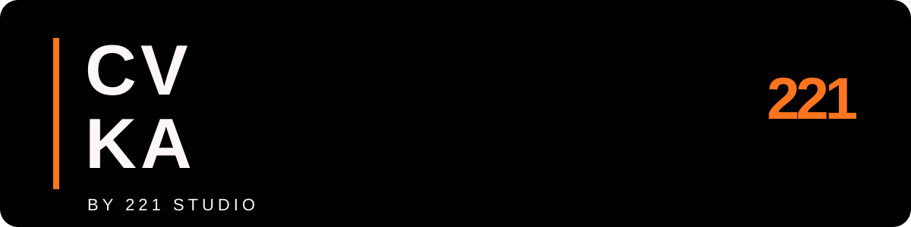

<div align="center">

[](https://221studio.pl/)

# CVKA

**CVKA is an open-source CV and resume builder by Nikodem Boniecki and 221 Studio.** Tailor a master resume to job descriptions, review AI-assisted edits, and export polished PDFs.

[221 Studio](https://221studio.pl/) · [GitHub repository](https://github.com/NikodemBoniecki/cvka) · [Setup guide](SETUP.md)

**English** | [Español](README.es.md) | [简体中文](README.zh-CN.md) | [日本語](README.ja.md) | [Português (BR)](README.pt-BR.md)

</div>

## What CVKA does

1. Upload or create a master resume.
2. Add a job description and tailor your resume for the role.
3. Review content, ATS checks, and keyword coverage.
4. Export the finished resume as a PDF.

CVKA runs locally with a FastAPI backend, Next.js frontend, and SQLite database. Configure a hosted AI provider or use a local model. The app does not require a user account.

## Quick start

See [SETUP.md](SETUP.md) for prerequisites and full instructions. With Docker installed:

```bash
git clone https://github.com/NikodemBoniecki/cvka.git
cd cvka
docker compose up --build
```

Open <http://localhost:3000>.

## Links

- [221 Studio](https://221studio.pl/)
- [CVKA source code and issue tracker](https://github.com/NikodemBoniecki/cvka)
- [Apache 2.0 license](LICENSE)
- [Third-party attribution](NOTICE)
